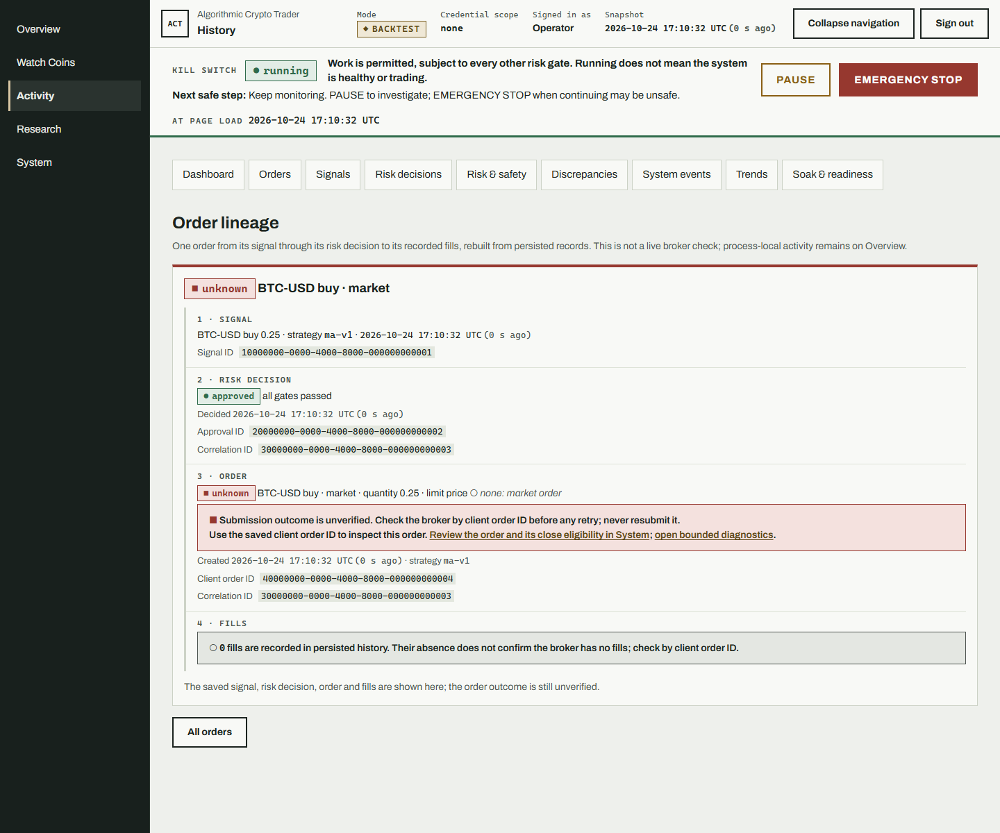
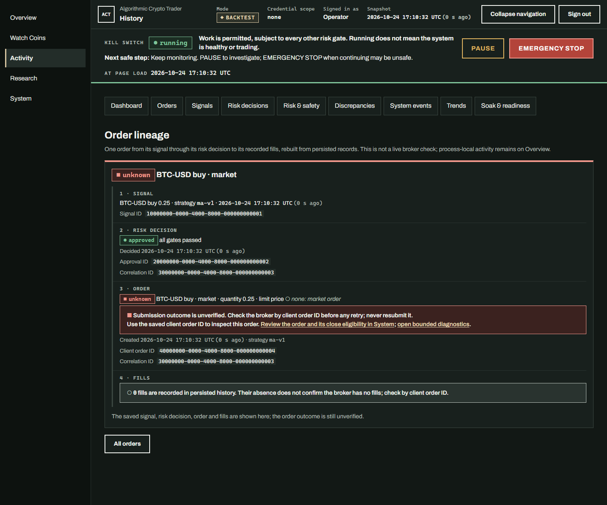
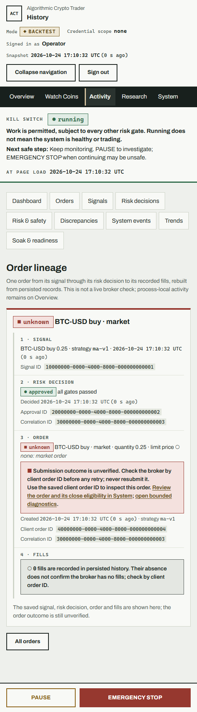
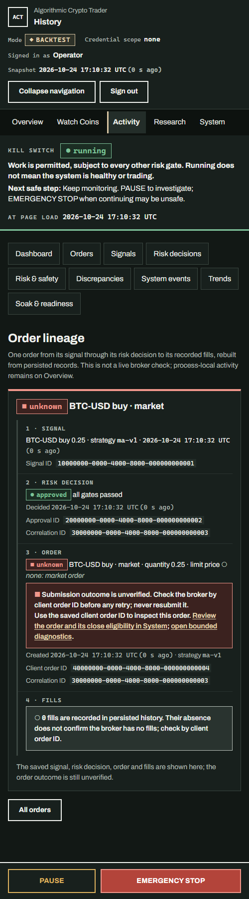

# C005 Activity lineage handoff

The Activity module at `/operator/history/orders` reads bounded persisted
history. Each order detail keeps the saved Signal → Risk decision → Order →
Fills chain, stable client-order-ID links, timestamps and existing subviews.
It states that saved history is not a live broker check and keeps process-local
activity on Overview.

`pending_submit` and `unknown` show the outcome as unverified, direct the
operator to inspect by the saved client order ID, and link to System's saved
order review and bounded diagnostics. Zero recorded local fills are not a
broker answer. Activity adds no submit, retry, close or kill-switch action.

## Visual review

Captured from the rendered Activity order detail with synthetic SQLite fixture
records: one approved decision, one `unknown` order, and no locally recorded
fills. The fixture IDs are stable, and no provider, exchange or live credential
was used. Desktop captures are 1440 CSS pixels wide; mobile captures are 500
CSS pixels wide. Both themes show the complete four-step lineage and the
unverified-outcome guidance.

| View | Screenshot |
| --- | --- |
| Desktop, light |  |
| Desktop, dark |  |
| Mobile, light |  |
| Mobile, dark |  |
