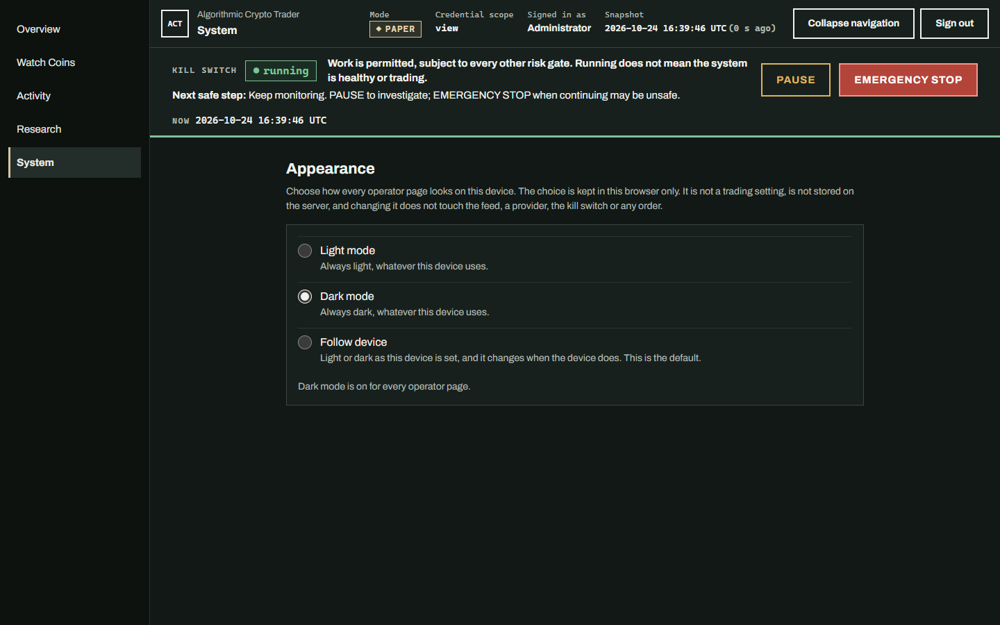
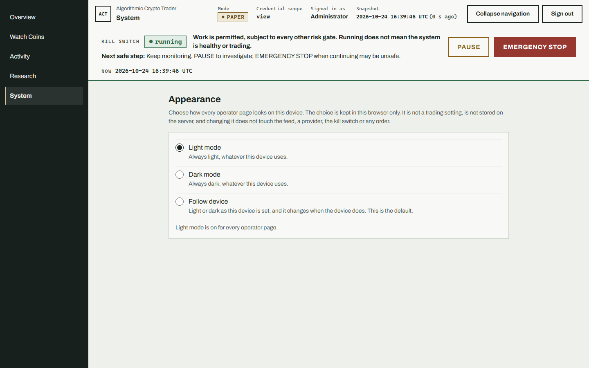
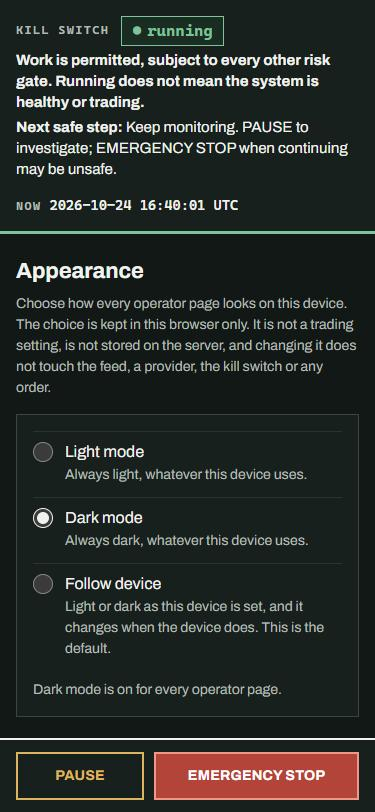
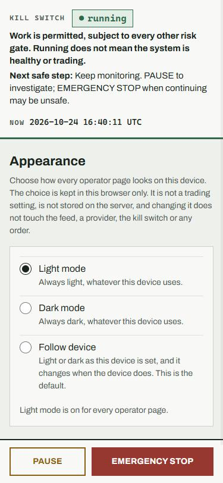

# C004 operator appearance handoff

**System > Appearance** (`/operator/system#appearance`) lets an operator choose how every operator page looks on the device they are using. It adds no route that accepts a choice, no server setting and no database column.

## Choices

| Choice | Result |
| --- | --- |
| **Light mode** | Every operator page uses the light palette, whatever the device is set to. |
| **Dark mode** | Every operator page uses the dark palette, whatever the device is set to. |
| **Follow device** | The device's light or dark setting decides, and the page changes when the device does. This is the default. |

The choice is stored in the browser's `localStorage` under `act.operator.appearance.v1` as `light`, `dark` or `system`. A missing, unreadable or unrecognised value means Follow device. It is per browser and per device: it does not follow the operator to another browser, and it is not stored on the server.

## How it is applied

- `operator-appearance.js` is a small same-origin script loaded, without `defer`, in the `<head>` of every operator page, before the stylesheet. It sets `data-theme="light"` or `data-theme="dark"` on `<html>` before the first paint, so a page does not flash the wrong palette. Follow device sets no attribute.
- `operator.css` keeps the existing palettes. Without `data-theme`, the `prefers-color-scheme: dark` query chooses. `data-theme="light"` is excluded from that query, so a dark device cannot override it, and `data-theme="dark"` applies the same dark tokens directly. Both set `color-scheme`, so form controls, scrollbars and focus use the chosen palette. The two dark token lists are identical, and a test compares them.
- Follow device is pure CSS. It responds to a device change without script, and the Appearance section's status line updates when the browser reports the change.
- The Markets chart reads the page's own colour tokens and redraws when `data-theme` or the device setting changes, so it matches the page. Its server-drawn SVG fallback already used those tokens.
- The script has no network, trading or settings code. It reads and writes only its one storage key and sets or clears only `data-theme`.

## Failure behaviour

| Condition | Result |
| --- | --- |
| JavaScript is off or blocked | The page follows the device. The choices stay hidden, with a note that they need JavaScript, so no inert control is offered. Navigation, PAUSE and EMERGENCY STOP are unaffected. |
| Storage is denied or unavailable | The page follows the device. A choice still applies to the current page, and the status line says it is not saved and lasts only until the operator leaves the page. |
| The stored value is corrupt or unknown | Follow device. |
| Another tab changes the choice | Open tabs follow the new choice. |

## Safety implications

- Choosing an appearance runs no request. It does not start the feed, call a provider, change a server setting, or alter the kill switch, orders, risk or any other trading state.
- No route, role, refusal or approval changed. The new script is served unauthenticated like the clock script, so the sign-in page can honour the choice. It is a fixed, reviewed, display-only file with no data in it.
- Status is never carried by colour alone in either theme: every status keeps its word and mark. A test checks every text, status and focus colour pair against WCAG AA contrast (4.5:1) in both palettes.
- No Content-Security-Policy was added or loosened. The Markets page keeps its own policy, and the script is an external same-origin file, so it works under it.

## Visual review

Captured from the same deterministic offline fixture as the C003 System handoff: no provider or exchange call was made. The choice was made with the real controls, and the desktop shots were taken on a device set to dark, so the Light capture shows the override. Desktop was captured at 1440 CSS pixels and mobile at 375, with no horizontal overflow. Other System sections and, on mobile, the page header are hidden in the captures so the section is visible.

| View | Screenshot |
| --- | --- |
| Desktop, dark |  |
| Desktop, light |  |
| Mobile, dark |  |
| Mobile, light |  |

Artboard data is illustrative. The page keeps shipped capabilities the artboards omit.
