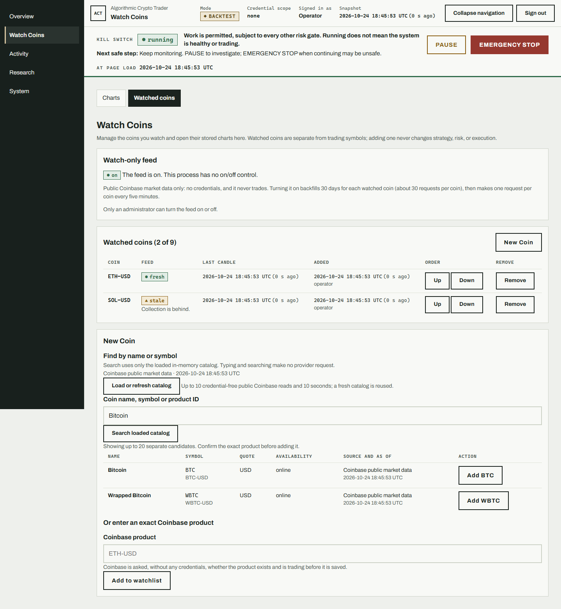
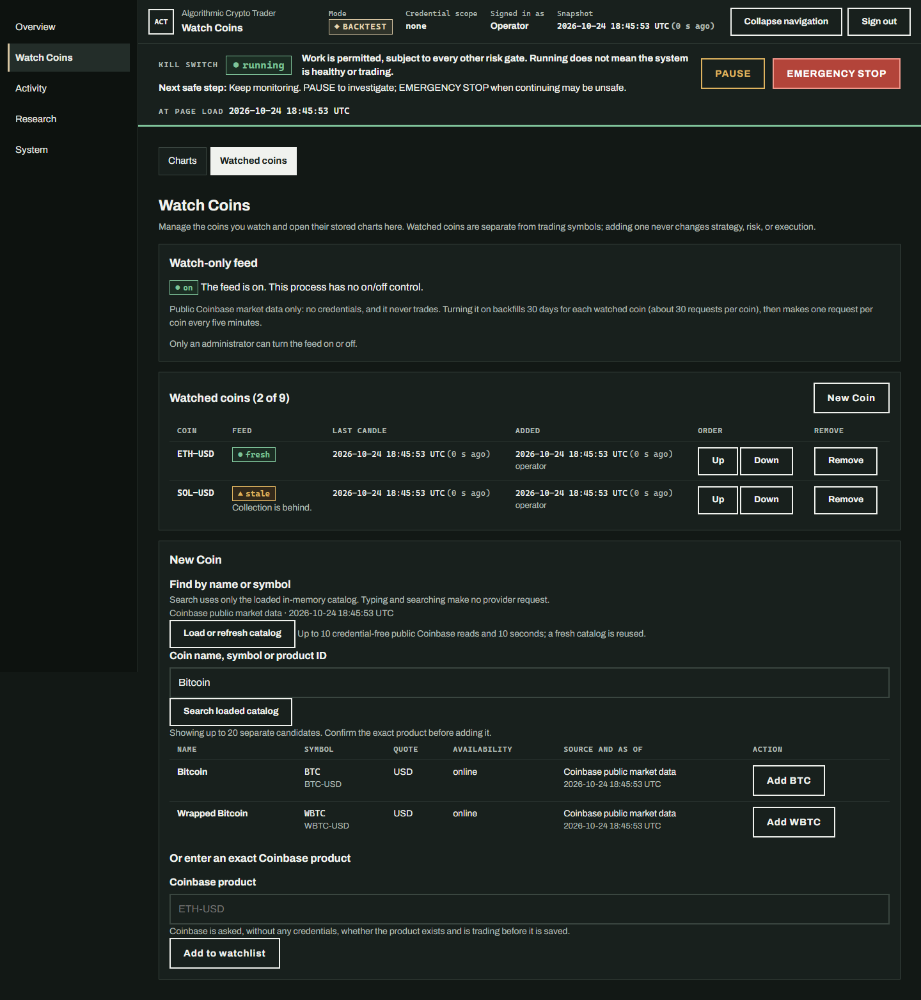
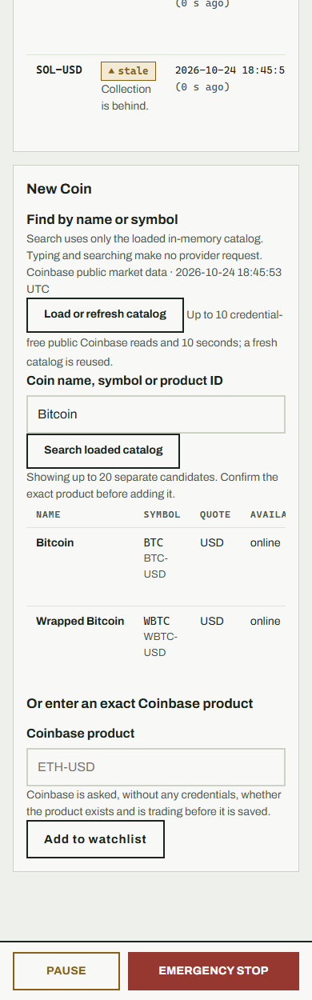
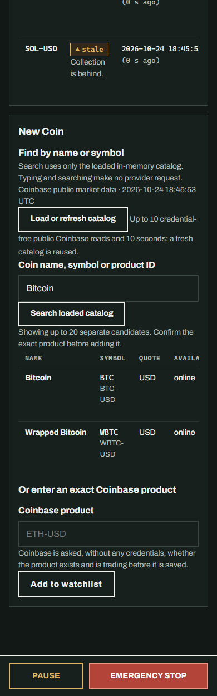

# C007 bounded coin-name catalog

The New Coin section in Watch Coins can search Coinbase public product names,
symbols, and canonical USD product IDs. The picker lists separate candidates
with their display name, base symbol, product ID, USD quote, availability,
source, and catalog as-of time. It does not infer a product from an absent name
or silently select an ambiguous match.

## Read and cache behavior

- Page loads, searches, and keystrokes read only the server's in-memory cache.
- **Load or refresh catalog** explicitly requests Coinbase's public List Public
  Products endpoint. Before the action, the page names its maximum budget: 10
  public requests, up to 500 rows each, at most 5000 products retained, and a
  10-second deadline. A cache younger than 15 minutes is reused without a
  request.
- Coinbase's response is filtered to online, enabled SPOT products whose
  product ID, base symbol, and quote agree and whose quote is USD. The picker
  does not expose raw provider records.
- A timeout, malformed or truncated page, rate limit, or provider failure does
  not replace the previous successful catalog. The UI labels the retained data
  stale with its original as-of time. With no successful catalog, name search
  is unavailable and the exact-symbol form remains available.
- Selecting a candidate submits its canonical product ID through the existing
  authenticated watchlist add route. That route repeats the established public
  product eligibility check before saving; the catalog never bypasses it.

The public endpoint fields used here are `product_id`, `base_display_symbol`,
`base_name`, `quote_currency_id`, `product_type`, `status`, `trading_disabled`,
and `is_disabled`, with `pagination.has_next` and `num_products` for completeness
checks. See Coinbase's [List Public Products API reference](https://docs.cdp.coinbase.com/api-reference/advanced-trade-api/rest-api/public/list-public-products).

## Safety and validation boundary

The catalog uses the watch-only Coinbase client, which has its own limiter and
circuit breaker and does not supply credentials. It issues GET requests only.
Catalog failures do not change the watch feed, the trading symbol list,
strategy, risk, order state, or reconciliation. Tests use deterministic mocked
responses and do not establish current live Coinbase behavior.

## Version

`0.19.0` → `0.20.0` (MINOR), for the new operator-visible coin-name selection
capability.

## Visual review

Screenshots use deterministic fixture catalog records and local watchlist
state. No Coinbase request, credential, order, or feed toggle was used.

| Viewport and appearance | Screenshot |
| --- | --- |
| Desktop, light |  |
| Desktop, dark |  |
| Mobile, light |  |
| Mobile, dark |  |
