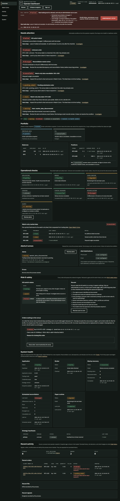
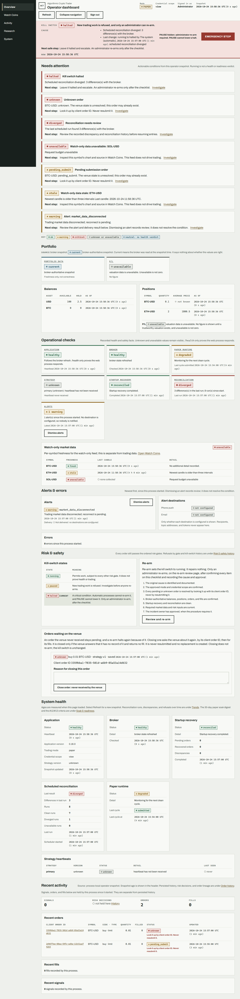

# C002 operator Overview handoff

## Layout

The Overview presents four groups in this order:

1. **Needs attention** — conditions that need an operator response, with a severity, recorded cause or unavailable reason, and a next step.
2. **Portfolio** — broker snapshot source and age, portfolio freshness, balance and position tables, and valuation-based P/L.
3. **Operational checks** — application and broker facts, runtime, strategy heartbeat, startup recovery, reconciliation, watch-only market data, alerts, and safety controls.
4. **Recent activity** — process-local signals, orders, and fills, with persisted history linked separately.

The attention list is built only from the current operator snapshot. An empty list says that no active incident was recorded in that snapshot; it is not a readiness verdict. If the read model is incomplete or unreadable, the page says so. Unknown and pending submission orders link to their persisted detail and instruct the operator to look them up by client order ID without resubmitting. A halt is explained by its recorded cause when available; the UI does not infer an unresolved order from the halted state.

Watch-only candle freshness is shown per symbol and clearly separated from trading market data. Portfolio source and snapshot age remain visible. Missing P/L stays unavailable rather than becoming zero, and the existing daily P/L and average-fill cost-basis calculations remain unchanged. Process-local activity is labeled as such; persisted history remains linked separately. Alert dismissal records review and does not claim that the underlying condition is resolved.

The current `Refresh` action remains the only refresh behavior. The Overview does not add provider writes or automatically refresh. Operator roles can follow persisted unresolved-order details; the existing admin-only close-order control remains restricted to administrators.

## Visual review

Captured against the deterministic local fixture in `preview_c002.py` with a reconciliation-divergence halt, one unknown order, one pending submission, a warning alert, per-symbol watch-feed freshness states, and broker-derived portfolio values. No provider or exchange calls were made. Desktop was captured at 1440 × 1000 CSS pixels; mobile at 390 × 844. Both system color schemes were inspected.

| View | Screenshot |
| --- | --- |
| Desktop, dark |  |
| Desktop, light |  |
| Mobile, dark |  |
| Mobile, light |  |

## Review notes

- The four groups read in the requested order at desktop and mobile widths.
- Attention rows retain readable labels and next steps in both themes. The unknown and pending-submission warnings remain explicit.
- Portfolio tables and operational cards wrap to a single column at mobile width without changing their meaning.
- Watch-only market data remains visually and textually separate from the trading broker/feed status.
- Existing system-health, safety, alert, watch-coins, activity, and history anchors remain in place.
