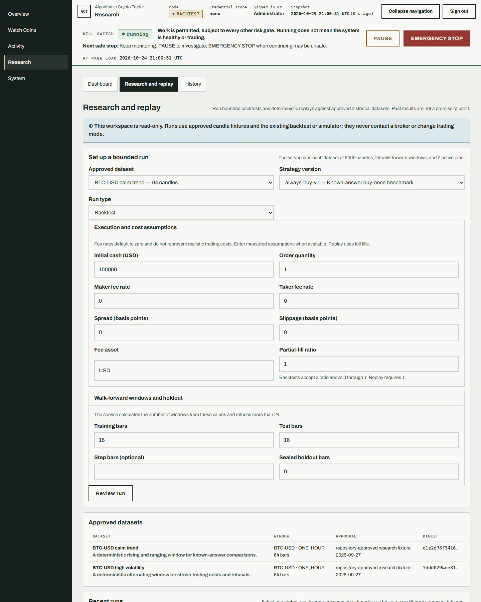
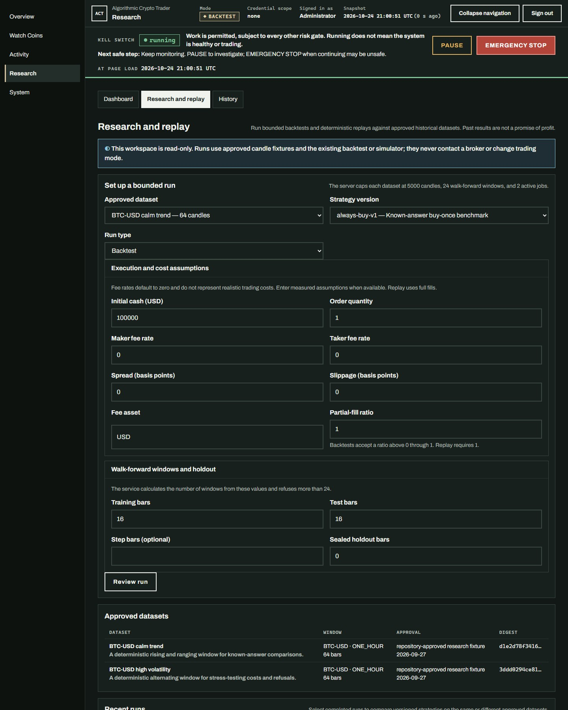
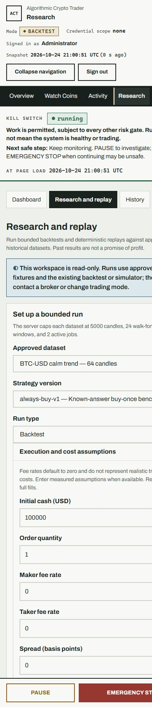
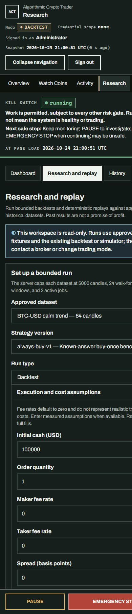
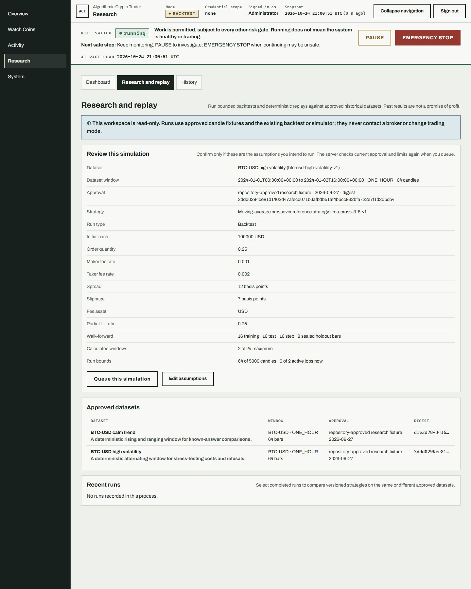
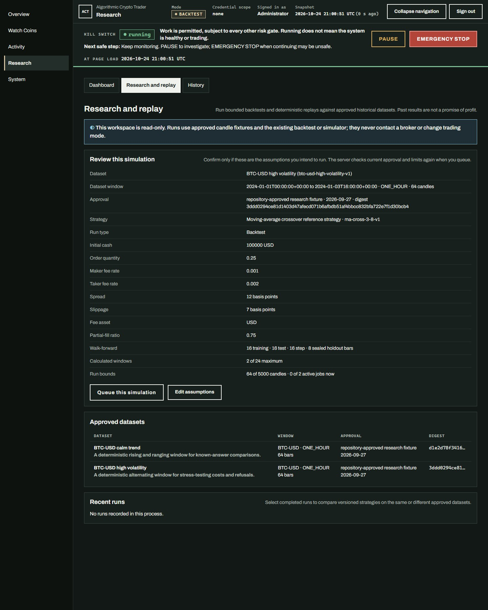
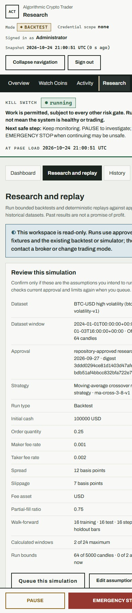
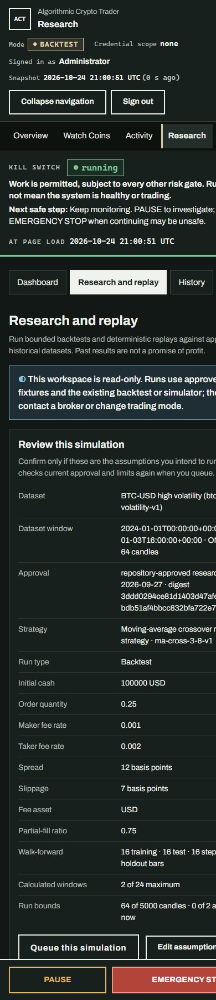

# C009 Research setup and review

Research now starts with the approved dataset, strategy version, and run type.
Execution and cost assumptions and walk-forward settings remain available in
accessible disclosures. The operator reviews the exact dataset identity,
strategy, assumptions, calculated windows, and current limits before queueing.
Queue confirmation repeats current server validation and can be used only once
for each review.

Fee rates default to zero, with a clear note that zero is not a realistic cost
estimate. The flow stays server-rendered and simulation-only; it does not call
a broker, place orders, or change trading mode.

## Version

`0.21.0` → `0.22.0` (MINOR), for the operator-visible setup and review flow.

## Visual review

Screenshots use deterministic, approved research fixtures in backtest mode.
The local fixture app had no configured broker or trading credentials.

### Setup

| View | Screenshot |
| --- | --- |
| Desktop, light |  |
| Desktop, dark |  |
| Mobile, light |  |
| Mobile, dark |  |

### Review

| View | Screenshot |
| --- | --- |
| Desktop, light |  |
| Desktop, dark |  |
| Mobile, light |  |
| Mobile, dark |  |
