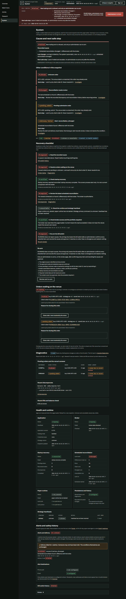
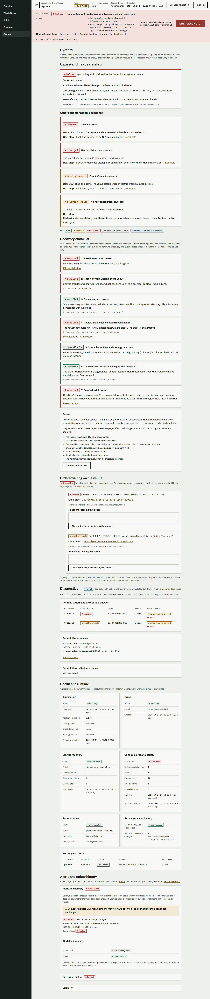
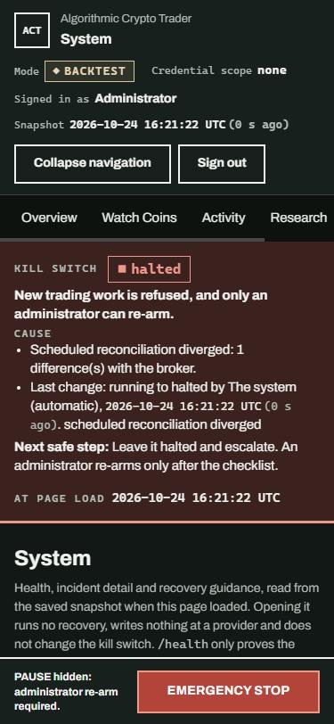
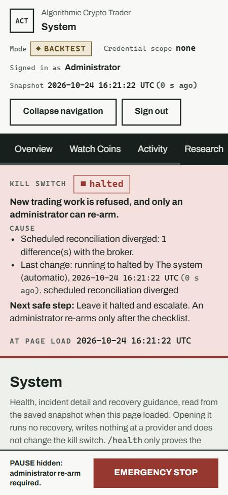

# C003 operator System handoff

`GET /operator/system` is the System destination in the shared workspace shell. Navigation and the page heading both read **System**. It needs the same operator sign-in as the Overview, and anonymous requests get `401`. A direct visit and a reload show the same page from a fresh read of the snapshot.

## Layout

1. **Cause and next safe step** — the recorded cause of a pause or halt, or "Cause unavailable" when nothing explains it, then the next safe step and any other recorded condition. A read model that is incomplete says so instead of reporting no incident.
2. **Recovery checklist** — seven ordered checks. Each status comes from evidence in the snapshot: *verified*, *required*, *unavailable*, or *stale* (a clean scheduled reconciliation older than three intervals, using the scheduler's own interval). The list is guidance. It starts no recovery and does not claim that broker reconciliation just completed. The Re-arm panel says that RUNNING does not repair causes.
3. **Orders waiting on the venue** — saved pending or unknown orders, visible to both roles, with their client order IDs linked to the existing order detail. Not checked, unreadable and empty are three different states. The existing close control is shown to administrators only, and the server keeps its own refusals.
4. **Diagnostics** — the bounded report `/operator/diagnostics` returns (newest five rows per section, orders and fills by short reference). Refused, failed, partly unavailable and read are distinct. A failed build is logged and shown as unavailable, never as text.
5. **Health and runtime** — the existing application (including version), broker, startup recovery, reconciliation and runtime facts, plus persistence and the strategy heartbeats.
6. **Alerts and safety history** — expandable groups. A delivery failure opens the alert group and is described as a notification problem, separate from the trading condition. Dismissal stays on the Overview and is described as review, not as clearing a halt. Kill-switch changes show "No recorded kill-switch change" when there are none.

The persistent safety bar keeps EMERGENCY STOP and, unless halted, PAUSE as plain POST forms, so both work without JavaScript. PAUSE still cannot lower a halt.

## Safety implications

- Viewing is read-only. The page refreshes the broker snapshot exactly as the Overview does and makes the same single `get_order` lookups (at most five, with a timeout) that `/operator/diagnostics` makes. It makes no provider write, no recovery, and no kill-switch transition.
- No route, role, checklist, reason or approval requirement changed. Re-arm, close-order, dismiss, pause and emergency stop keep their existing paths and refusals.
- Diagnostics remain refused in `live` mode or with a trade-capable credential scope.
- `/health` is described only as a liveness check, never as readiness.

## Visual review

Captured from a deterministic offline fixture (a reconciliation-divergence halt, one unknown and one pending order, a failed alert delivery and a stored discrepancy). No provider or exchange call was made. Desktop was captured at 1440 CSS pixels in both color schemes. Mobile was checked at 375 CSS pixels with no horizontal overflow; only the top of the page is shown.

| View | Screenshot |
| --- | --- |
| Desktop, dark |  |
| Desktop, light |  |
| Mobile, dark |  |
| Mobile, light |  |

Artboard data is illustrative. The page keeps shipped capabilities the artboards omit, such as the order close control and the alert destinations.
