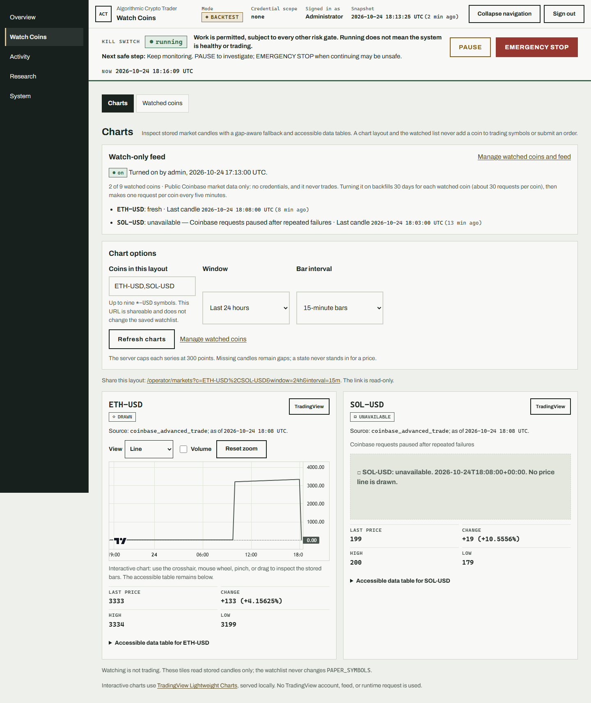
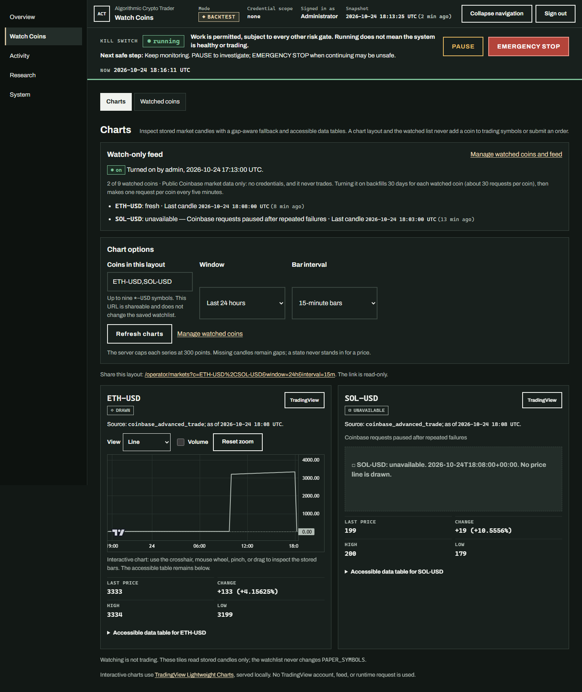
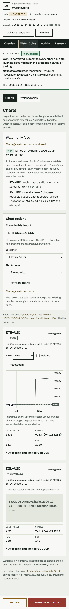
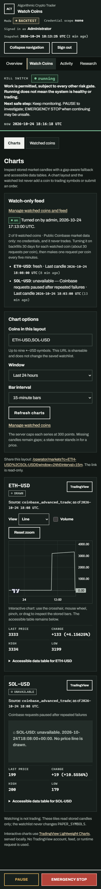
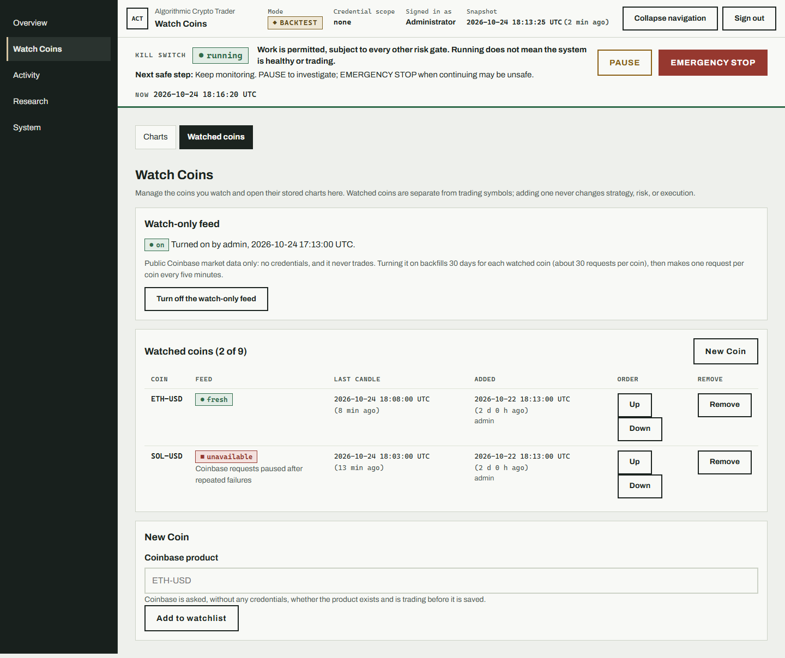
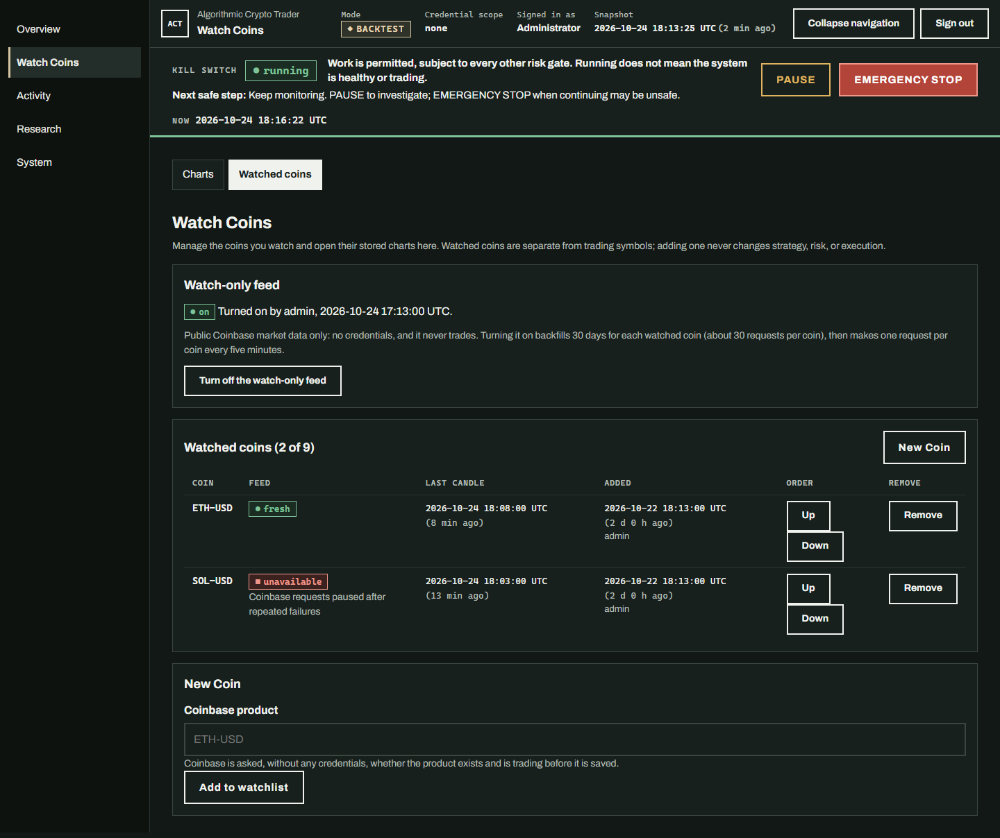
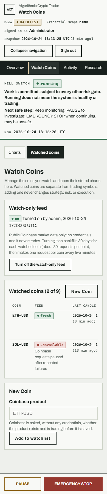
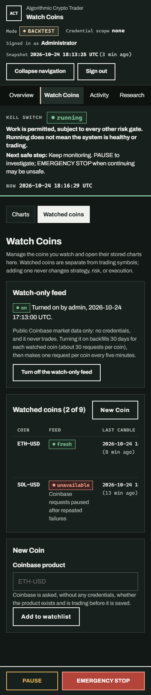

# C006 Watch Coins workspace

The Watch Coins module links the saved watched-coin list and stored market charts.
`/operator/watchlist` and `/operator/markets` remain direct, reloadable routes and
keep their existing JSON and form contracts. Both mark Watch Coins as the active
primary destination and provide a two-view sub-navigation.

The Charts view shows the watch-only feed's on/off source, the configured list
limit, request budget, per-coin collection state, and last-candle freshness. It
also preserves each chart's source, gap-aware server-drawn SVG, accessible data
table, bot-activity lineage links, external TradingView link, and optional local
Lightweight Charts enhancement. The Watched coins view retains saved order,
add/remove/reorder forms, and the separate administrator-only feed toggle. New
Coin opens the existing canonical Coinbase product-symbol form.

Adding, removing, or reordering watched coins does not modify `PAPER_SYMBOLS`,
strategy, risk, mode, or order state. Opening either view performs reads only.
Turning the feed on remains a separate explicit administrator action. Empty,
full, off, waiting-to-collect, stale, unavailable, partial-error, and no-candle
states remain distinct; a failed watchlist read is never presented as an empty
list. The presentation uses no provider write, new endpoint, or database change.

## Version

`0.18.1` → `0.19.0` (MINOR). This ships the consolidated Watch Coins workspace,
including feed and saved-list state beside charts.

## Visual review

Screenshots use deterministic local candle and feed-status records. No provider,
exchange, live credential, or order action was used. Desktop captures
are 1440 CSS pixels wide; mobile captures are 390 CSS pixels wide. Light and dark
appearances were reviewed for both the Charts and Watched coins views.

| View | Screenshot |
| --- | --- |
| Charts, desktop light |  |
| Charts, desktop dark |  |
| Charts, mobile light |  |
| Charts, mobile dark |  |
| Watched coins, desktop light |  |
| Watched coins, desktop dark |  |
| Watched coins, mobile light |  |
| Watched coins, mobile dark |  |
