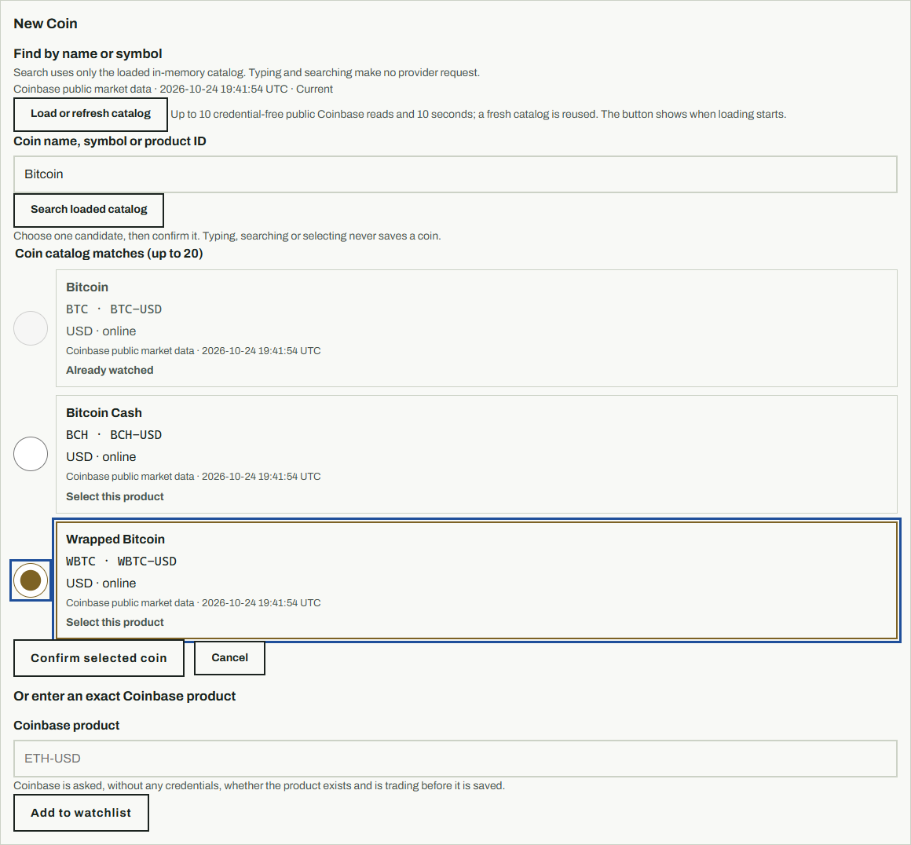
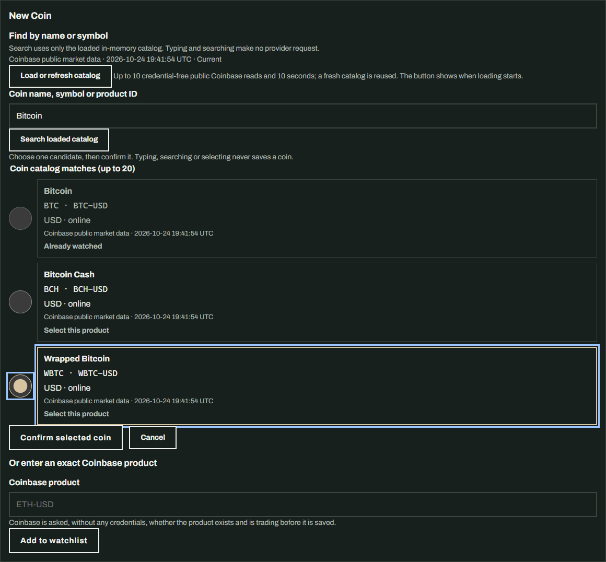
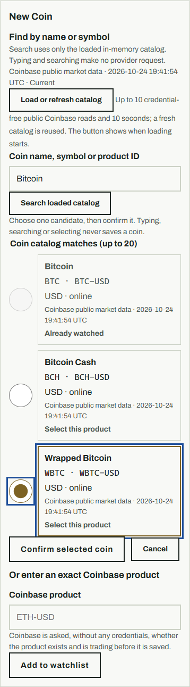
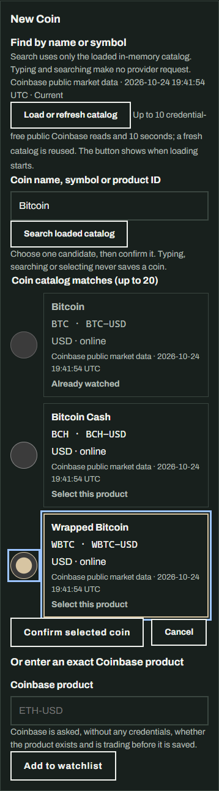

# C008 New Coin picker

New Coin searches the loaded watch-only catalog by coin name, symbol, or
canonical USD product. Each candidate is a separate keyboard and touch target;
the operator selects one and confirms before the existing server-side
validation and save path runs. Already-watched candidates are labeled and
disabled. Search and candidate selection work without JavaScript, and an exact
product form remains available when the catalog has no result.

After a successful save, the page shows the canonical product and the current
collection state. Cancel returns to the New Coin control. Page rendering,
search, selection, and cancel do not make provider requests or mutate the
watchlist. The only new script labels an explicit catalog refresh while it is
in progress.

## Version

`0.20.0` → `0.21.0` (MINOR), for the operator-visible name/symbol picker and
confirmation flow.

## Visual review

Screenshots show the server-rendered selection and explicit confirmation with
deterministic local catalog data. No real provider, exchange, live credential,
or order action was used.

| View | Screenshot |
| --- | --- |
| New Coin, desktop light |  |
| New Coin, desktop dark |  |
| New Coin, mobile light |  |
| New Coin, mobile dark |  |
