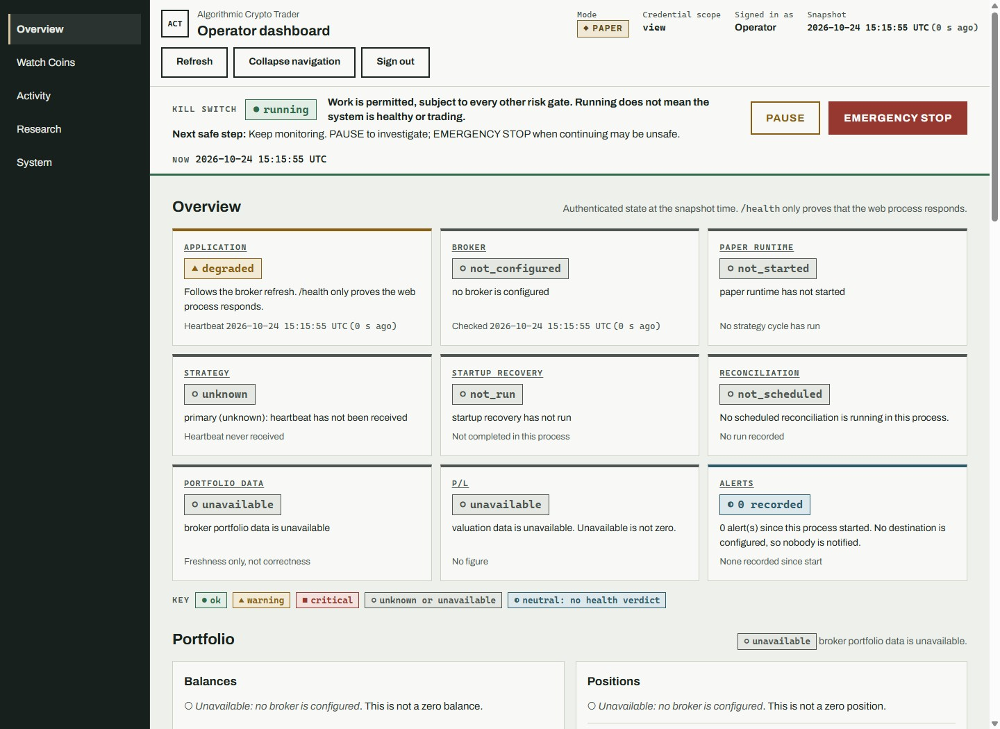
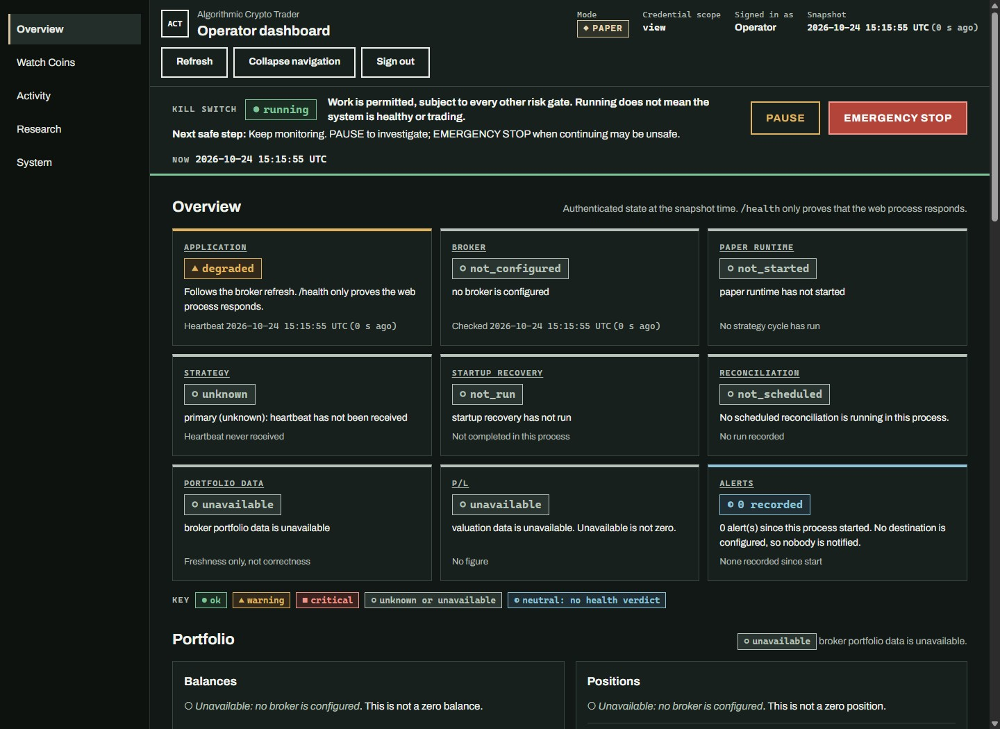
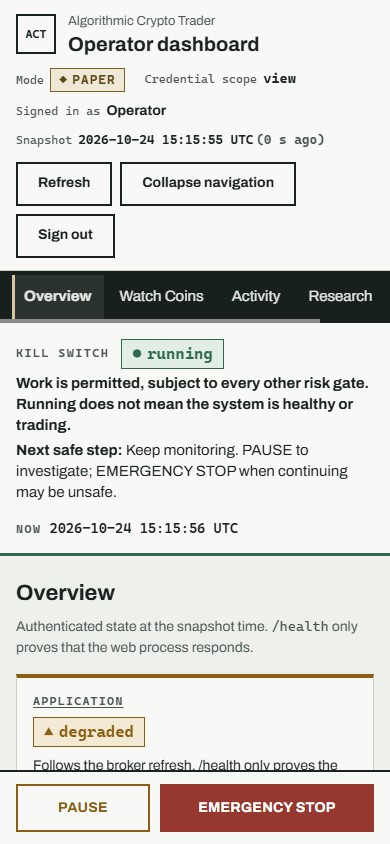
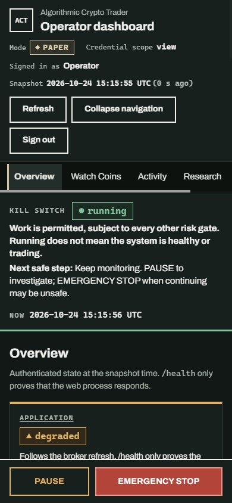

# Operator workspace design handoff — C001 v1

- **Status:** implemented in the C001 draft PR; runtime screenshots show the local paper-mode build.
- **Visual direction:** restrained green and gray surfaces, textual state labels, no remote assets, and the existing light/dark system palettes.
- **Interaction model:** server-rendered FastAPI/Jinja pages with ordinary links and POST forms. JavaScript only advances the existing server-anchored UTC clock and saves the browser-local sidebar preference.

## Overview content follow-up

Issue #175 groups the existing Overview content into **Needs attention**, **Portfolio**, **Operational checks**, and **Recent activity**. The nine status summaries below remain available, with the portfolio and P/L summaries placed in Portfolio and the other operational states under Operational checks. See the [C002 Overview handoff](operator-overview-c002-v1.md) for the attention rules, source labels, and implementation screenshots.

1. Application
2. Broker
3. Paper runtime
4. Strategy
5. Startup recovery
6. Reconciliation
7. Portfolio data
8. P/L
9. Alerts

The detailed dashboard sections remain Overview, Portfolio, Activity, Alerts & errors, Risk & safety, and System health. Current, last-known, unavailable, unknown, and stale values remain distinct.

## Route map

| Primary destination | Working target | Preserved secondary views |
| --- | --- | --- |
| Overview | `/operator` | Portfolio, Activity, Alerts & errors, Risk & safety, System health anchors |
| Watch Coins | `/operator/watchlist` | `/operator/markets`; watchlist and server-drawn chart fallbacks |
| Activity | `/operator/history/orders` | Signals, risk decisions, discrepancies, events, trends, soak/readiness, order lineage |
| Research | `/operator/research` | Existing catalog, replay and result routes |
| System | `/operator/system` | Overview System health anchor; `/operator/diagnostics`, re-arm and order-close routes (C003) |

The current watchlist's Add a coin symbol form and separate market-chart page are retained. C001 does not replace the flow with a new coin-name editor. Manual appearance choices and the dedicated System content were left to later cards (System in C003, appearance choices in C004; see `operator-appearance-c004-v1.md`); C001 artboards document the existing OS/browser light and dark appearances.

> **Implemented in C006 (#179):** the existing chart and watched-list routes now share a Watch Coins sub-navigation. Both remain directly addressable. The Charts view also shows watch-feed status, source, collection freshness and request budget; the Watched coins view keeps the saved list controls and canonical-symbol New Coin form.

Sign-in, sign-out results, safety-control results, admin re-arm review, order-close review, soak, trends, history subviews, and lineage keep their existing routes and authorization. The shared shell marks the current primary destination when it can be determined from the request or anchor.

## Header and safety strip

The shared header shows the literal trading mode, credential scope, server-granted role, data snapshot age, and server-anchored UTC clock. The snapshot age does not tick with the clock. Without JavaScript, the time is labeled **At page load**.

The safety strip stays above module content and keeps the persistent kill-switch state, explanation, next safe step, PAUSE, and EMERGENCY STOP visible. HALTED still hides PAUSE and requires the existing administrator re-arm review. Both controls remain ordinary authenticated POST forms.

The sidebar starts expanded. Its labeled button supports keyboard and touch, exposes `aria-expanded` and `aria-controls`, and saves the preference under a versioned browser-local key. If storage cannot be read or written, the navigation remains usable and expanded. Collapsing it does not move or hide the safety strip.

## Light and dark desktop artboards

These are screenshots of the local implementation with deterministic, unavailable broker data; they are runtime evidence for the shell only, not provider capability evidence.

### Desktop — light

### Desktop — dark

## Mobile artboards at 390 CSS pixels

### Mobile — light

### Mobile — dark

The primary navigation scrolls horizontally at the mobile breakpoint. Safety actions remain in a fixed, touch-sized control row at the viewport bottom, with matching bottom space reserved in the page.

## Preserved capabilities

- Authenticated session and token routes, role refusals, sign-in, sign-out, and server-rendered control results.
- Direct links, browser history, history filters and pagination, charts and table fallbacks, watchlist, and research/replay.
- Persistent RUNNING, PAUSED, and HALTED state; PAUSE cannot lower HALTED; re-arm stays administrator-only.
- Server-rendered safety POSTs with JavaScript disabled.
- The existing UTC server-time baseline and independent data snapshot age.
- Honest empty, stale, unavailable, failed, last-known, and UNKNOWN messaging.
- Provider-neutral pages, same-origin assets, no database or provider writes from navigation or preference handling.
